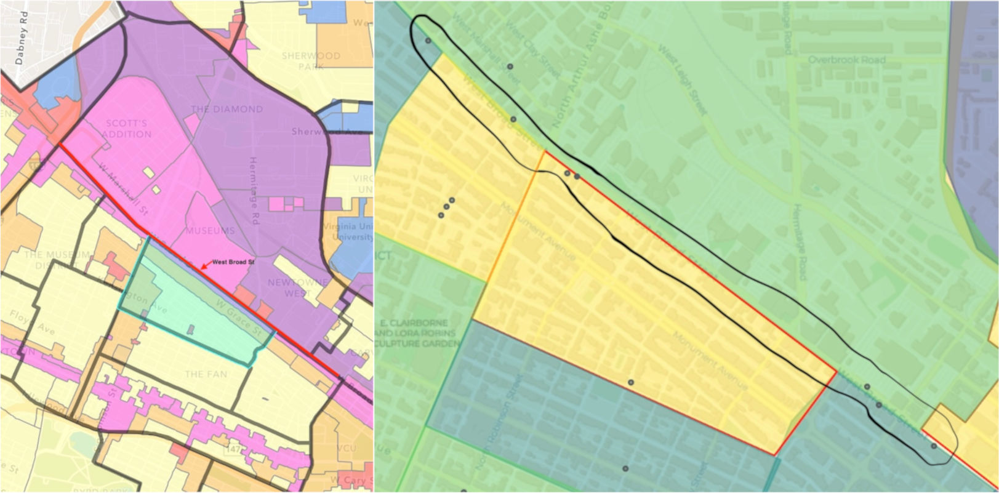

## Summary

*Shops selling hemp-derived THC (HD-THC) products have become a common sight in Virginia, and I wanted to investigate what kinds of neighborhoods they tend to occupy. Using shop locations across the state, I modeled census-tract counts against health behaviors, income, and business-vacancy measures using a Bayesian spatial Poisson model (BYM2). Higher-income tracts had fewer expected shops (IRR 0.85, 95% CrI 0.76–0.96), while more populous tracts had more (IRR 1.19); business vacancy and low-income share showed no clear associations, and an apparent smoking association weakened after accounting for spatial structure. Most residual variation was unstructured rather than geographically correlated (φ ≈ 0.27), although the analysis could not account for potentially important commercial factors such as rental costs and zoning restrictions.*

## Introduction

In the summer of 2025, RVAmag published [The New Corner Store](https://rvamag.com/news-headlines/the-new-corner-store-how-vape-shops-took-over-richmond.html), which associated the proliferation of vape shops in Richmond to a "perfect storm" of legal loopholes, financial timing, and inconsistent regulatory enforcement. I've traveled much of Virginia over the past few years, and while I can't say whether the same mechanisms apply elsewhere, the spread of these shops doesn't seem unique to Richmond. More recently, I began noticing a pattern of these retailers occupying storefronts in areas where other businesses were closing. Having lived in Appalachia for much of my life, I couldn't help but associate this pattern with the economic hardship and substance-use problems that have affected so many communities in my home region, particularly during the opioid crisis.

I don't mean to suggest that stores selling HD-THC are employing strategies comparable to the pharmaceutical marketing practices associated with that crisis. However, the apparent overlap between these retailers and economically distressed commercial areas raised a question I wanted to investigate: ***are these shops locating in neighborhoods based on the characteristics of the people who live there, or are they primarily following supply-side opportunities, such as inexpensive commercial space, regulatory conditions, and access to product***? To explore this, I collected shop locations across Virginia and compared their distribution with census-tract measures of income, health behaviors, population, and commercial vacancy.

### What the article argues

I highly recommend reading the article in full. For my purposes, what matters most is the set of mechanisms it points to, because they’re the supply-side half of my question and mostly don’t depend on who lives nearby.

* **A legal gray area.** The 2018 Farm Bill legalized hemp and its derivatives, and the article argues shops used the resulting gray area to sell products without the rules that apply to tobacco. The same gap covers HD-THC, the focus of this project.

* **Cheap, easy space.** According to the article, PPP loans and stimulus money made it easy to take on storefronts in strip malls and shopping plazas, where barriers to entry are low. This is the mechanism my vacancy variable is meant to capture.

* **Thin enforcement and loose supply.** Shop owners quoted in the article say regulators spend their time on detailed inspections of shops trying to comply while gray-market shops go largely ignored. Smokables like vapes and flower also fall largely outside VDACS’s oversight, and wholesalers reportedly move large volumes with little documentation.

* **Loose licensing.** The article reports that Richmond kept issuing business licenses with few restrictions until shortly before it ran. One source estimated about 70 registered hemp locations in the city and perhaps three times as many operating without registration.

Understanding why those gaps exist starts with how Virginia’s cannabis laws evolved—something I studied firsthand as an intern at the Cannabis Control Authority.

### Background

In 2024, I interned as a data and research analyst at the Virginia Cannabis Control Authority (CCA), where I had the chance to learn in detail about, what was at the time, a confusing regulatory landscape of cannabis and THC derivatives.

To give some background, during his last year in office in 2021, Democratic Governor Ralph Northam signed [Virginia SB 1406 and its companion HB 2312](https://legacylis.virginia.gov/000/chapter551.pdf), legalizing adult possession of recereational marijuana and establishing a framework for a retail recreational cannabis market to open starting January 1, 2024. However, significant portions of the retail framework required further legislative action before taking effect. Following Republican Glenn Youngkin's victory over Democrat Terry McAuliffe in the 2021 gubernatorial election, efforts to establish a functioning recreational market stalled. Youngkin subsequently vetoed retail-market legislation in 2024 and 2025, citing concerns about public health and safety, among other issues.

One consequence was that the CCA, an agency established partly to administer Virginia's regulated recreational marijuana market, was unable to fully carry out that responsibility. Meanwhile, businesses selling HD-THC (which I'll often shorten to HD-THC in my writing) products operated under a separate regulatory framework, with oversight primarily involving the Virginia Department of Agriculture and Consumer Services (VDACS).

As an intern, I found this latter situation particularly troubling. I could understand, to a certain degree, some of the public-health concerns Youngkin raised about legalizing recreational cannabis sales, especially regarding vulnerable populations. However, allowing an existing market for intoxicating THC products to operate under a different system of oversight, while opposing legislation intended to establish a regulated recreational marijuana market, seemed somewhat at odds with those concerns. Although the CCA's authority over recreational marijuana would not automatically have extended to every hemp-derived product, the distinction between the two regulatory systems raised questions for me about how Virginia was approaching an already established market for intoxicating products. It was around this time when I first began looking into shops that sell HD-THC products in the state, and the release of the RVA Mag article mentioned earlier helped articulate some of the ideas and questions I was asking myself about their proliferation. 

Additional to my time at the CCA and experience with geospatial analysis via my masters program, interest in the public health and economic aspects of this project came from works by [Anne Case and Angus Deaton on *Deaths of Despair*](https://www.jstor.org/stable/j.ctvpr7rb2), [David Autor regarding the *China Shock*](https://www.nber.org/papers/w21906), and Beth Macy with her books [*Factory Man*](https://www.hachettebookgroup.com/titles/beth-macy/factory-man/9780316231435/?lens=little-brown) and [*Dopesick*](https://www.hachettebookgroup.com/titles/beth-macy/dopesick/9780316551281/?lens=little-brown). 

The concept of *deaths of despair* will likely be familiar to readers affected by or knowledgeable of the opioid crisis. Broadly speaking, it examines connections between diminished economic and social conditions and increases in mortality associated with drug overdoses, alcohol-related disease, and suicide. Related research on the *China shock* looks into the rapid influx of labor intensive Chinese goods in the 2000s and how that contributed to domestic manufacturing job losses and economonic distruption in certain communities. More recent works like [Pierce and Schott's paper](https://www.aeaweb.org/articles?id=10.1257/aeri.20180396) on the consequences of Permanent Normal Trade Relations (PNTR) with China have also identified associations between greater exposure to trade-related economic disruption and increased drug-overdose mortality. 

Many of these economic challenges directly affected parts of Virginia. In *Factory Man*, Macy describes the effects of increased foreign competition on the state's furniture industry, particularly in southern and southwestern Virginia. The contrast between the economic experiences of different regions of the state, and the public-health challenges facing many communities affected by industrial decline, contributed to my interest in how economic conditions might relate to the distribution of HD-THC retailers.

---
## Data, Methods & Results
The following **Building the Model** collapsible section will give a brief technical overview on how I went about building the model I ended up using. I will also present many of its results, while leaving a more detailed discussion of them for a later section. For readers who aren't as concerned about the technical backgrounds of this work, and moreso care about the findings this paper presents, I would recommend skipping ahead to that section. 

::: {.callout-note collapse="true"}
### Building the Model

### Getting Shop Counts

HD-THC shop locations were obtained from the VDACS publicly available registration list from February 2026, Google Maps API, and OpenStreetMap (OSM). After identifying eligible retailers and removing duplicate locations, shops were assigned to Virginia census tracts to calculate tract-level counts. The table below summarizes the contribution of each source. For more information on retailer identification, data collection, and preprocessing, see the appendix.

| Source         | Count    |
|----------------|----------|
| VDACS only     | 1192     |
| Google only    | 484      |
| OSM only       | 269      |
| VDACS & Google | 62       |
| VDACS & OSM    | 30       |
| Google & OSM   | 60       |
| All            | 16       |
| **TOTAL**      | **2113** |

### Neighborhood Data and Explanatory Variables

To see which neighborhood characteristics were associated with HD-THC shop counts, I combined census-tract measures of health behaviors, household income, population, and commercial activity. Additional information on preprocessing and variable construction is provided in the appendix.

I excluded tracts with no recorded businesses or missing required CDC PLACES estimates, and selected explanatory variables based on their relevance to the study's demographic, economic, and public-health questions. To check for multicollinearity, I calculated variance inflation factors (VIF) and retained a specification where all predictors scored below 5. I z-score standardized every variable except `log_ams_bus` (which serves as the model's exposure offset, detailed below) in order to make their estimated associations directly comparable.

#### Variable Reference Table

| Variable           | What it measures                              | Source     |
|--------------------|-----------------------------------------------|------------|
| BINGE              | Adult binge drinking prevalence (%)           | CDC PLACES |
| CSMOKING           | Adult cigarette smoking prevalence (%)        | CDC PLACES |
| ACCESS2            | Uninsured adults aged 18–64 (%)               | CDC PLACES |
| SLEEP              | Short sleep duration prevalence (%)           | CDC PLACES |
| CHECKUP            | Routine medical checkup prevalence (%)        | CDC PLACES |
| log_TotalPop18plus | Adult population (log-transformed)            | CDC PLACES |
| activ_any          | Any new business-address activations (binary) | HUD-USPS   |
| log_bus_vac        | Vacant business addresses (log-transformed)   | HUD-USPS   |
| log_ams_bus        | Total business addresses (log-transformed)    | HUD-USPS   |
| high_inc           | Households earning $150,000+ (%)              | ACS        |
| low_inc            | Households earning under $25,000 (%)          | ACS        |

#### CDC PLACES Health Data

The CDC's [PLACES: Local Data for Better Health](https://www.cdc.gov/places/index.html) dataset provides model-based estimates of health behaviors, health outcomes, and preventive-care measures for census tracts. Variables from this dataset were included to examine whether neighborhood-level health characteristics were associated with HD-THC retailer locations. Because they are tract-level estimates, they don't directly measure the behaviors of individual shop customers. In their unstandardized forms, all variables from this dataset, besides `log_TotalPop18plus` (which is a log-transformed count), represent an estimated percentage of the adult population in each census tract.

#### HUD-USPS Vacancy Data

The Department of Housing and Urban Development's [Aggregated USPS Administrative Data On Address Vacancies](https://www.huduser.gov/portal/datasets/usps.html) (HUD-USPS) provides census-tract measures of residential and business-address activity, including vacancy and activation counts. I used this data to represent aspects of the commercial environment and potential economic distress.

- `activ_any`: A binary indicator equal to 1 if any business-address activations were recorded in a tract, and 0 otherwise. I used it in place of the original activation count because the distribution was heavily skewed and contained a large proportion of zeros.
- `log_ams_bus`: The log-transformed total business count, which serves as the model's exposure offset. Including this offset allows expected HD-THC shop counts to be modeled relative to the overall commercial base in each tract.

#### ACS Income Data

[2024 American Community Survey (ACS) five-year estimates](https://www.census.gov/data/developers/data-sets/acs-5year/2024.html) provide estimated household counts across 16 annual income brackets in 2024 inflation-adjusted dollars. I converted the top and bottom brackets (high_inc and low_inc) into percentages of total households in each census tract prior to z-score standardizing.

### Where Are Virginia's HD-THC Shops?

Before examining which neighborhood characteristics were associated with HD-THC retailers, I looked into their geographic distribution across Virginia census tracts. To see see this distribution of shops mapped out, continue to the [Interactive Map](#interactive-map) section.

An initial [Moran's I test](https://doc.esri.com/en/arcgis-pro/latest/tool-reference/spatial-statistics/h-how-spatial-autocorrelation-moran-s-i-spatial-st.html) found evidence of positive spatial autocorrelation in raw shop counts (pseudo-p = 0.001). In other words, neighboring census tracts tended to have more similar shop counts than would be expected under the spatial-randomization null hypothesis (which would have shops locate completely randomly across the state).

Initial clustering doesn't necessarily imply that shops are locating near each other because of shared neighborhood characteristics. Differences in population, business activity, and other factors may also produce geographic patterns in shop counts. In order to look at these relationships while accounting for the remaining geographic variation, I turned to spatial count modeling.

### Modeling approach

I started with a [Poisson model](https://web.mit.edu/urban_or_book/www/book/chapter3/3.8.html), which represents a standard starting point for modeling counts of relatively uncommon events, like the number of HD-THC shops within a census tract. Since the initial model showed evidence of overdispersion, I also tested a [Negative Binomial (NB) model](https://library.virginia.edu/data/articles/getting-started-with-negative-binomial-regression-modeling), which allows more flexibility in the variance of the observed counts.

However, the residual Moran's I tests indicated significant spatial autocorrelation in both non-spatial models, suggesting that neither specification adequately accounted for the geographic structure remaining after controlling for the included explanatory variables.

To address this, I introduced spatial random effects using the [Besag–York–Mollié 2 (BYM2) model](https://www.paulamoraga.com/book-geospatial/sec-arealdatatheory.html). BYM2 allows the expected number of shops in each tract to vary beyond what is explained by the observed neighborhood characteristics. It separates this additional variation into two components: one that allows neighboring tracts to have similar residual effects, and another that captures variation not explicitly structured by the neighborhood relationships. 

For those interested in the mathematical formulation, prior specifications, and implementation, I've included a more detailed explanation in the appendix.

### Choosing the Final Model

Based on information criteria and posterior predictive check (PPC) comparison tables below, I concluded that there was sufficient evidence to **support the Poisson+BYM2 specification over the NB+BYM2 one**, with the caveat that Poisson+BYM2 still has some predictive misfit.

I compared the non-spatial and spatial specifications using information criteria and posterior predictive checks (PPCs). The information criteria favored Poisson+BYM2, while the PPCs suggested that it generally reproduced the observed distribution of shop counts better than NB+BYM2, though neither model was without some limitations. 

#### Information Criteria Comparison

*Lower scores indicate better model fit under each criterion.*

| Model Specification             | DIC        | WAIC       | Δ WAIC |
|---------------------------------|------------|------------|--------|
| Poisson (Non-spatial)           | 5131.3     | 5137.8     | +216.4 |
| Negative Binomial (Non-spatial) | 5023       | 5023.4     | +102   |
| **Poisson + BYM2**              | **4903.4** | **4921.4** | **0**  |
| Negative Binomial + BYM2        | 5023.9     | 5024.3     | +102.9 |

Poisson+BYM2 had the lowest WAIC, outperforming both non-spatial specifications and NB+BYM2. This suggests that incorporating spatial random effects improved the its fit, while introducing an additional negative binomial dispersion parameter didn't improve performance under this criterion.

#### Posterior Predictive Comparison

These checks provide another way to evaluate model performance through comparing the observed shop-count distribution with datasets simulated from each fitted model.

*Values are posterior predictive means with 95% predictive intervals in parentheses.*

| Summary Metric          | Observed | Poisson + BYM2(Mean [95% CI]) | NB + BYM2(Mean [95% CI]) |
|-------------------------|----------|-------------------------------|--------------------------|
| Total Vape Stores       | 2113     | 2175 (2039 – 2310)            | 2145 (1987 – 2317)       |
| Sample Variance         | 2.21     | 2.49 (2.14 – 2.93)            | 2.62 (2.10 – 3.33)       |
| Zero-Store Areas (0)    | 1155     | 1117 (1070 – 1166)            | 1135 (1075 – 1196)       |
| High-Density Areas (8+) | 10       | 18.1 (11 – 27)                | 20.0 (11 – 30)           |
| Max Stores in an Area   | 13       | 15.4 (11 – 24)                | 17.5 (12 – 29)           |

Poisson+BYM2 produced predictive means closer to the observed variance and maximum shop count, while NB+BYM2 did somewhat better at reproducing the total number of shops and number of tracts with no shops. The observed values for these metrics nevertheless fell within the 95% predictive intervals of both models.

A notable issue was the number of tracts containing eight or more shops. Only 10 tracts hit this threshold in the observed data, compared with predictive means of approximately 18 for Poisson+BYM2 and 20 for NB+BYM2. The observed count for high-density areas also fell just below the lower bounds of both models' 95% predictive intervals, which suggests that neither specification entirely captured this feature of the upper tail.

All together, the information criteria and posterior predictive checks favored Poisson+BYM2 as the main specification. Even though the model generally performed better than NB+BYM2 on the examined measures, it still showed some problems with reproducing the frequency of higher shop counts. Additional diagnostics, including residual spatial autocorrelation tests and more detailed posterior predictive comparisons, are provided in the appendix.

### Results

#### Poisson+BYM2 Incedence Rate Ratios (IRRs)

For all of the fixed effects, the table below compares their IRRs from the baseline non-spatial Poisson model, a Poisson+IID model, and the final Poisson+BYM2 model to see how estimated associations adjust when controlling for just unmeasured tract-level overdispersion, and then unmeasured tract-level overdispersion combined with spatial autocorrelation.

*For help with variable names, see the previous [reference table](#variable-reference-table).*

| Variable           | Standard Poisson IRR (95% CrI) | P(IRR>1) | Poisson + IID IRR (95% CrI) | P(IRR>1) | Poisson + BYM2 IRR (95% CrI) | P(IRR>1) |
|--------------------|--------------------------------|----------|-----------------------------|----------|------------------------------|----------|
| BINGE              | 1.079 (0.986–1.180)            | 95.0%    | 1.095 (0.981–1.221)         | 94.8%    | 1.097 (0.956–1.256)          | 90.8%    |
| CSMOKING           | 1.203 (1.091–1.327)            | 100.0%   | 1.215 (1.077–1.371)         | 99.9%    | 1.065 (0.927–1.224)          | 81.3%    |
| SLEEP              | 0.922 (0.863–0.985)            | 0.8%     | 0.926 (0.854–1.004)         | 3.2%     | 1.015 (0.917–1.126)          | 61.2%    |
| ACCESS2            | 0.948 (0.868–1.036)            | 11.9%    | 0.948 (0.852–1.056)         | 16.5%    | 1.048 (0.931–1.181)          | 78.1%    |
| CHECKUP            | 1.090 (0.993–1.196)            | 96.5%    | 1.092 (0.975–1.223)         | 93.6%    | 1.106 (0.961–1.272)          | 92.1%    |
| log_bus_vac        | 1.021 (0.972–1.072)            | 79.3%    | 1.009 (0.949–1.073)         | 61.1%    | 1.019 (0.956–1.085)          | 71.6%    |
| activ_any          | 0.963 (0.926–1.002)            | 3.2%     | 0.966 (0.919–1.015)         | 8.4%     | 0.978 (0.931–1.028)          | 18.8%    |
| log_TotalPop18plus | 1.200 (1.142–1.262)            | 100.0%   | 1.208 (1.138–1.283)         | 100.0%   | 1.191 (1.121–1.266)          | 100.0%   |
| high_inc           | 0.743 (0.685–0.804)            | 0.0%     | 0.735 (0.668–0.809)         | 0.0%     | 0.851 (0.755–0.961)          | 0.5%     |
| low_inc            | 0.999 (0.934–1.068)            | 48.6%    | 0.992 (0.914–1.077)         | 42.4%    | 0.968 (0.889–1.053)          | 22.3%    |
| log_ams_bus        | 0.727 (0.687–0.769)            | 0.0%     | 0.752 (0.702–0.807)         | 0.0%     | 0.744 (0.694–0.798)          | 0.0%     |

##### Reading the table

Each IRR is the multiplicative change in the expected shop count, relative to the business base, for a one-SD increase in the predictor (all predictors except `log_ams_bus` are z-scored, so an IRR of 0.85 corresponds to roughly 15% fewer shops). For log-transformed predictors, I convert to an elasticity, ln(IRR), which gives the percent change in expected shops per 1% change in the predictor. I considered an association clear only when the 95% credible interval excludes 1, and I report P(IRR > 1) as the posterior probability (shown as a percentage) that the association is positive.

Because z-scoring standardizes these predictors into abstract SD units, the table below provides their unstandardized means and standard deviations so the effects can be mapped back to real-world scales.

| Variables          | Mean  | Std Dev | Unit        |
|--------------------|-------|---------|-------------|
| BINGE              | 14.50 | 2.24    | Percentage  |
| CSMOKING           | 12.88 | 4.65    | Percentage  |
| ACCESS2            | 8.87  | 3.59    | Percentage  |
| SLEEP              | 36.46 | 5.07    | Percentage  |
| CHECKUP            | 79.11 | 2.90    | Percentage  |
| activ_any          | 0.18  | 0.38    | Binary      |
| log_TotalPop18plus | 7.97  | 0.41    | Natural log |
| log_bus_vac        | 1.24  | 1.46    | Natural log |
| low_inc            | 12.88 | 10.24   | Percentage  |
| high_inc           | 27.93 | 20.60   | Percentage  |

#### Clear associations

Higher-income share (IRR 0.85, 95% CrI 0.76–0.96) went with fewer shops. A 1% larger adult population went with roughly 0.42% more shops per business (95% CrI about 0.28% to 0.57%). Separately, the business base scaled sub-linearly: a 1% larger base went with about 0.70% more shops (about 0.64% to 0.77%). 

#### No clear association

Vacancy, low-income share, and the activation variable had intervals centered near 1 that rule out large effects, and the remaining health variables were not clearly distinguishable from zero.

#### What changed with spatial structure

CSMOKING and SLEEP showed clear associations in the non-spatial models that did not survive BYM2. BINGE and CHECKUP stayed positive (P ≈ 91–92%) but with intervals including 1.
:::

## Interactive Map

> The map compares observed HD-THC shop locations with the geographic patterns estimated by the spatial model. Areas with elevated spatial multipliers are locations where the model estimates more shops than would otherwise be expected based on the included explanatory variables.

<iframe
  src="maps/virginia_hdthc_map.html"
  width="100%"
  height="650"
  style="border: none;"
  loading="lazy">
</iframe>

### Exploring the Interactive Map

The map contains two toggleable layers, **Spatial Multiplier** and **HD-THC Shops**, which can be turned on or off using the layer control in the upper-right corner.

#### HD-THC Shops Layer

This layer displays the recorded locations of shops selling hemp-derived THC products across Virginia. It can be toggled independently of the Spatial Multiplier layer, allowing readers to compare the observed distribution of retailers against the geographic patterns estimated by the model.

#### Spatial Multiplier Layer

This layer visualizes the estimated spatial effects from the Poisson+BYM2 model across Virginia's census tracts. The color scheme uses a Fisher-Jenks natural breaks classification, which groups similar values together while highlighting larger differences between groups. This helps reveal geographic patterns and potential outliers that might be less apparent using simpler classification methods.

Clicking a census tract reveals its standardized explanatory variables (with the exception of log_ams_bus, which remains log-scaled), while hovering over a tract displays the following information:

* **geoid**: The census tract's geographic identification code (FIPS).
* **county**: The county or independent city containing the tract.
* **count**: The observed number of HD-THC shops within the tract.
* **Predicted Shop Count**: The model's estimated number of HD-THC shops for the tract, accounting for its explanatory variables and spatial effects.
* **Prediction Uncertainty (SD)**: The posterior standard deviation of the predicted shop count, providing an indication of uncertainty around the model's estimate.
* **Estimated Spatial Multiplier**: The estimated multiplicative effect of the BYM2 spatial random effect on the expected shop count. A value of 1.0 indicates no adjustment, while 1.5 represents a 50% increase and 0.7 represents a 30% decrease relative to the model's prediction without that spatial effect.
* **Multiplier Uncertainty (SD)**: The posterior standard deviation of the spatial multiplier, indicating uncertainty in the estimated spatial effect.
* **Probability of 50%+ Elevated Rate**: Also referred to as the **Exceedance Probability**, this represents the posterior probability that the spatial multiplier exceeds 1.5, corresponding to an increase of more than 50% in the expected shop count relative to the model's prediction without the spatial effect.

Since the model includes business addresses as an exposure adjustment, the spatial multiplier represents an adjustment to the expected shop count after accounting for this exposure and the other explanatory variables.

##### Identifying potential hotspots

Census tracts outlined in orange or red have an exceedance probability greater than 0.90, meaning the model assigns more than a 90% probability that their spatial multiplier exceeds 1.5.

* **Orange outlines**: Tracts identified by the Poisson+BYM2 model.
* **Red outlines**: Tracts identified by both the Poisson+BYM2 and a separate Poisson+IID model.

The additional Poisson+IID model serves as a robustness check. Some particularly rural or geographically isolated tracts have relatively few neighboring census tracts, which can make their estimated spatial effects more sensitive to the structure of the adjacency graph. Comparing results against a model with independent tract-level random effects helps identify areas whose elevated estimates are not solely dependent on BYM2's geographically structured smoothing component.

Red-outlined tracts therefore represent areas where elevated estimates persist across both model specifications, providing additional support for their identification as potential hotspots. The table below identifies these tracts, and gives some of their posterior spatial multiplier estimates from the BYM2 model specification.

Click here to view elevated tracts table

| GeoID       | county            | Estimated Spatial Multiplier | Multiplier Uncertainty (SD) | Probability of 50%+ Elevated Rate |
|-------------|-------------------|------------------------------|-----------------------------|-----------------------------------|
| 51051040200 |  Dickenson County |                        4.897 |                       2.553 |                             0.987 |
| 51087200126 |    Henrico County |                        3.648 |                       1.402 |                             0.987 |
| 51121020900 | Montgomery County |                        2.794 |                       1.030 |                             0.942 |
| 51161031201 |    Roanoke County |                        3.520 |                       1.584 |                             0.964 |
| 51179010212 |   Stafford County |                        2.911 |                       1.274 |                             0.917 |
| 51185021102 |   Tazewell County |                        3.245 |                       1.326 |                             0.962 |
| 51760020502 |     Richmond city |                        3.350 |                       1.272 |                             0.978 |
| 51760040201 |     Richmond city |                        3.274 |                       1.543 |                             0.938 |
| 51760040500 |     Richmond city |                        3.587 |                       1.553 |                             0.972 |
| 51775010100 |        Salem city |                        2.852 |                       1.039 |                             0.951 |
| 51775010200 |        Salem city |                        3.039 |                       1.066 |                             0.972 |

### Interpreting the Spatial Model

An interesting finding from the spatial model is that much of the remaining geographic variation appears to be specific to individual census tracts rather than shared among neighboring areas.

The BYM2 model distinguishes between geographically structured variation, which reflects similarities among neighboring census tracts, and unstructured variation, which captures residual differences between individual tracts. Its estimated mixing parameter (φ ≈ 0.21) suggests that the unstructured component contributes more to the overall spatial random effect.

This distinction is particularly relevant when examining the interactive map. Although some HD-THC retailers cluster within recognizable commercial corridors, neighboring census tracts can have substantially different commercial environments. Differences in zoning, land use, or other unmeasured local characteristics may help explain why the model identifies considerable tract-specific variation.

A more detailed explanation of the BYM2 model and its estimated hyperparameters is provided in the technical appendix.

## Discussion

**What does the geographic distribution of HD-THC shops tell us about the relationship between retail opportunity, neighborhood characteristics, and public health—and what can’t this analysis tell us?** 

### Population and income were the clearest demographic associations

The positive association with population is perhaps the strongest evidence in the model consistent with a demand-oriented explanation of shop locations. While the business-count exposure term accounts for the broader concentration of businesses, the population coefficient suggests that, given two tracts with similar business counts and other modeled characteristics, the one with more people will generally have a higher expected number of HD-THC shops. Specifically, a one-standard-deviation increase in log-transformed adult population was associated with approximately 19% more expected shops (IRR 1.19, 95% CrI 1.12–1.27).

This relationship may also help explain some of the elevated spatial multipliers in relatively sparsely populated tracts, particularly in western Virginia. For example, a tract with a relatively small population might serve as a commercial hub for surrounding rural communities and attract customers from well beyond its own borders. This tract could have more shops than the model would otherwise expect based on its population and other characteristics, even if its absolute number of shops remains relatively low. While the model can’t identify where customers originate, this illustrates how the population served by a commercial area may differ from the population living within its census-tract boundaries.

The inverse association with high-income households was another relatively clear finding. A standard deviation increase in the share of households earning over $150,000 was associated with approximately 15% fewer expected shops (IRR 0.85, 95% CrI 0.76–0.96). This suggests that HD-THC retailers tend to be less prevalent in higher-income tracts, even after accounting for differences in population, business counts, and other modeled characteristics.

Determining why this relationship exists is slightly difficult. A possible explanation involves differences in consumer preferences or recreational THC use across income groups. For example, a [2024 Gallup analysis](https://news.gallup.com/poll/642851/cannabis-greatest-among-lower-income-less-educated.aspx) found that regular cannabis use was more common among respondents from lower-income households than those from higher-income households. However, national cannabis consumption patterns don’t necessarily reflect demand for hemp-derived THC products in Virginia, nor do they establish that customers purchase these products in their own neighborhoods.

Commercial conditions offer another possible explanation. Differences in zoning, retail development, and commercial rents could affect where these businesses can operate, independently of the preferences of nearby residents. Because the model doesn’t include these factors, it can’t determine whether the negative association with high-income households primarily reflects consumer demand, the commercial environment, or some combination of them.

### Health-behavior findings were less conclusive than I may have initially thought.

Compared with population and income, the health-behavior variables gave less conclusive explanations for the distribution of HD-THC retailers. Binge drinking prevalence (`BINGE`) and routine medical checkup prevalence (`CHECKUP`) both had suggestive positive posterior associations (though their 95% credible intervals included 1). Cigarette smoking prevalence (`CSMOKING`), meanwhile, showed a substantially weaker association after accounting for spatial structure. One explanation could be that the non-spatial model attributed some shared geographic variation in smoking prevalence and shop counts to the smoking coefficient, whereas the BYM2 model could account for some of that variation through its random effects. This indicates the importance of considering geographic structure when interpreting relationships between neighborhood health characteristics and retailer locations.

Another important limitation of the smoking variable is that CDC PLACES measures cigarette smoking prevalence, rather than nicotine vaping or other forms of nicotine consumption. In Virginia, many businesses selling hemp-derived THC products advertise themselves primarily as vape shops rather than conventional tobacco outlets (potentially insert photographs here). Customers of these businesses may vape nicotine or THC products without regularly smoking cigarettes, meaning cigarette-smoking prevalence may not accurately represent the consumer behaviors more relevant to these retailers.

Data from SAMHSA's [2024 National Survey on Drug Use and Health](https://www.samhsa.gov/data/sites/default/files/reports/rpt56287/2024-nsduh-annual-national/2024-nsduh-annual-national-html-071425-edited/2024-nsduh-annual-national.htm#:~:text=1B) survey provides some support for distinguishing these behaviors. Nicotine vaping, THC vaping, and binge drinking are generally more prevalent among younger adults, while cigarette smoking is comparatively more prevalent in older age groups. These differences suggest that cigarette-smoking prevalence may not be a particularly effective proxy for the populations most likely to use vaping or recreational THC products.

The suggestive positive association with binge drinking is interesting in this context (IRR 1.10, 95% CrI 0.96–1.26). One possibility is that binge-drinking prevalence reflects broader demographic or behavioral characteristics associated with recreational substance use, including THC consumption. An alternative explanation involves the commercial environments in which these businesses operate. [Research](ttps://www.mdpi.com/2220-9964/14/1/4) on marijuana dispensary locations in New York City has identified associations between dispensary locations and certain neighboring land uses, including adult businesses, suggesting that the surrounding commercial environment may influence where cannabis-related retailers locate. It’s possible that nightlife-oriented commercial areas like corridors containing bars, clubs, and late-night restaurants provide similarly favorable environments for HD-THC retailers.

These explanations aren’t necessarily mutually exclusive. Areas with higher estimated binge-drinking prevalence might also contain demographic characteristics or commercial environments associated with recreational THC consumption. However, CDC PLACES measures the estimated health behaviors of residents, not the characteristics of businesses or the people visiting an area. Consequently, the model can’t establish whether the positive association with binge drinking reflects consumer preferences, the surrounding retail environment, or other unmeasured characteristics.

Routine medical checkup prevalence (`CHECKUP`) presented another interesting, although less intuitive, result. Its suggestive positive association with shop counts (IRR 1.11, 95% CrI 0.96–1.27) does not necessarily imply a direct relationship between preventive healthcare utilization and demand for HD-THC products. Instead, `CHECKUP` may reflect broader characteristics of communities, including differences in healthcare access, socioeconomic conditions, age composition, and patterns of healthcare utilization. Some of these characteristics may overlap with information captured by the model's income and healthcare-access variables. It’s difficult to determine what underlying characteristics might account for the observed association, though.

Taken together, these findings provide limited evidence that the health behaviors examined in this study independently explain the distribution of HD-THC retailers. Although `BINGE` and `CHECKUP` retained suggestive positive associations, their uncertainty leaves room for a range of effect sizes, while the apparent association with cigarette smoking weakened after spatial adjustment. The results don’t rule out relationships between substance-use behaviors and retail locations, but they suggest that the available health indicators may be insufficient to characterize those relationships.

### Commercial geography doesn't necessarily follow neighborhood boundaries

One of the largest limitations of this analysis is the lack of detailed information on the commercial environments where HD-THC shops operate. While the model accounts for the number of businesses in each tract and includes a measure of commercial vacancy, neither variable necessarily captures the availability, suitability, or cost of retail space. The commercial vacancy variable showed little evidence of association with shop counts (IRR 1.02, 95% CrI 0.96–1.09), but that doesn’t necessarily mean that commercial real estate conditions are unimportant. Differences in zoning, rental costs, road accessibility, and the types of businesses already operating in an area all could influence where retailers choose to locate.

Another consideration is that census-tract boundaries do not always correspond to commercial geographies. While census tracts provide a useful way to compare neighborhood demographic and health characteristics, commercial activity is often concentrated along particular roads or within relatively small portions of a tract.

As illustrated by the zoning patterns in Richmond in the image below, a tract may contain a relatively small commercial corridor surrounded primarily by residential land, while adjacent tracts can have substantially different land-use compositions. Consequently, neighboring tracts may have very different opportunities for commercial development despite sharing a boundary.

The red line in the zoning map highlights West Broad Street, a major east–west arterial road through Richmond that serves as an important commercial corridor and also forms the boundary of several census tracts. The corresponding view of the interactive map shows several HD-THC retailers located along this stretch of road. This illustrates a potential limitation of using census tracts to examine retail geography: businesses along the same commercial corridor can be assigned to different tracts simply because they fall on opposite sides of a boundary. Although these businesses may occupy similar commercial environments, their shop counts are associated with different tract-level demographic, socioeconomic, and health characteristics.

This does not necessarily invalidate the associations identified by the model, but it illustrates why census-tract characteristics may provide an incomplete picture of the factors influencing retail location decisions. Without more detailed information on zoning, commercial rents, and road-level retail environments, it is difficult to determine how much of the observed distribution reflects characteristics of nearby residents versus the commercial opportunities available to retailers.

### Much of the remaining variation was specific to individual tracts

Beyond the associations with the included explanatory variables, the BYM2 model also identified differences between census tracts that were not fully accounted for by their observed characteristics. However, these remaining differences were not dominated by a smooth pattern of similarity between neighboring tracts. The model's estimated mixing parameter (φ ≈ 0.21, 95% CrI 0.07–0.42) suggests that the unstructured component contributed more to the residual geographic variation than the spatially structured component.

In practical terms, this means that the remaining differences in expected shop counts favored a larger contribution from variation specific to individual tracts and weren’t primarily characterized by neighboring tracts having similar residual effects. This doesn’t mean that geographic location was unimportant, but rather that the remaining variation wasn’t predominantly explained by the particular neighborhood relationships represented by the model's adjacency structure.

One possible explanation involves the commercial-geography limitations discussed above. Neighboring tracts can have substantially different zoning compositions, and commercial corridors may follow or cross tract boundaries. These differences could contribute to variation in shop counts that is not well represented by a model relying on shared census-tract boundaries to define spatial relationships. However, the unstructured component also captures other sources of unexplained tract-level variation, and the model can’t determine whether zoning, commercial accessibility, unobserved consumer characteristics, or other factors are responsible for its relatively large contribution.

### Limitations

Besides the missing commercial rent, zoning, and land-use information discussed earlier, there are a few other limitations worth acknowledging.

The first concerns census tracts as the unit of analysis. The relationships identified in this study describe associations between tract-level characteristics and shop counts, not the behaviors or circumstances of individual residents or customers. For example, an association between cigarette-smoking prevalence and shop counts would not necessarily imply that residents who smoke cigarettes are more likely to purchase products from these retailers. Census-tract averages can also obscure considerable differences within neighborhoods, particularly when commercial and residential zones occupy different parts of the same tract. This makes it difficult to determine how closely the characteristics of nearby residents correspond to those of the people actually visiting HD-THC shops.

Another deals with the cross-sectional nature of the analysis. Since I only have shop locations from earlier this year, I can’t determine whether retailers followed, preceded, or appeared alongside changes in neighborhood characteristics. Despite it being one of the original observations motivating this project, this means I can’t directly evaluate whether HD-THC shops have proliferated in recent years. I attempted to locate historical retailer information through older VDACS registration lists and archived web records, but ultimately wasn’t able to assemble a reliable time series of shop locations. Without that data, an analysis of how the distribution of these businesses has changed over time is outside the scope of this project.

The available health-behavior measures present another limitation. CDC PLACES provides modeled estimates of selected health characteristics among residents, rather than direct measures of HD-THC consumption or consumer demand. As mentioned earlier, cigarette-smoking prevalence doesn’t necessarily capture nicotine vaping, THC vaping, or other behaviors that may be more relevant to these retailers (making more detailed information on vaping and THC consumption useful for future research). Similarly, the lack of retailer and customer data makes it impossible to directly examine business-location decisions, customer origins, purchasing patterns, or marketing practices. Because of this, the analysis can’t establish whether retailers deliberately target particular demographics or whether they locate mostly due to other commercial considerations.

### More Remarks on the Spatial Model

A slightly more technical limitation concerns how the BYM2 model defines relationships between neighboring census tracts. I used a queen adjacency structure, which considers tracts to be neighbors whenever they share a boundary or even a single point. While this is a common and defensible approach to modeling areal data, it’s also a relatively simple representation of geographic relationships.

In reality, neighboring tracts may have very different levels of connectivity. Two tracts sharing a long commercial highway might have considerably more interaction than two tracts touching at a single corner. Likewise, geographic features like mountains, rivers, and roads can also influence how easily people travel between neighboring areas. These differences, however, aren’t directly captured by the queen adjacency structure.

This limitation may be particularly relevant to a study of retail locations, where accessibility and transportation networks could matter as much as geographic proximity. Possible extensions could be to compare the results with alternative neighborhood structures based on road connectivity, travel times, or shared-boundary lengths.

There are, however, some reasons to be less concerned about the model's dependence on the adjacency structure. The relatively low BYM2 mixing parameter (φ ≈ 0.21) suggests that the unstructured component contributed more to the remaining geographic variation than the spatially structured component. Additionally, comparisons with an independent tract-level random-effects (IID) model showed that some areas with elevated spatial multipliers were identified under both specifications. While neither result establishes that the choice of adjacency structure had little influence on the estimates, they do suggest that at least some of the remaining tract-level variation wasn’t entirely dependent on the model's neighborhood relationships.

Ultimately, testing alternative spatial-weight structures would be a useful next step of this analysis, especially given the differences in transportation networks and commercial geography across Virginia.

### What comes next for Virginia's HD-THC retailers?

In [August 2026](https://cca.virginia.gov/news/virginias-new-marijuana-and-hemp-laws-what-you-need-to-know), Virginia eliminated an exemption that previously allowed hemp products containing more than two milligrams of total THC per package, provided they maintained a CBD-to-THC ratio of at least 25:1. The change effectively removed a pathway for selling certain higher-potency hemp products outside the state's medical cannabis system. Meanwhile, [federal legislation](https://www.wilsonelser.com/publications/the-great-hemp-reset-how-the-federal-ban-on-intoxicating-hemp-products-will-reshape-risk-and-coverage) enacted in November 2025 established an even stricter limit of 0.4 milligrams of THC and certain similar cannabinoids per container, with most provisions scheduled to take effect in December 2026. These restrictions arrive ahead of Virginia's planned recreational cannabis retail market, scheduled to open July 1, 2027. Together, these developments introduce considerable uncertainty for businesses that have relied on selling intoxicating hemp products.

Research from other states offers some insight into how these changes might affect Virginia's retailers, although the evidence is mixed. A [2025 study examining tobacco retailers in New York City, San Francisco, and Philadelphia](https://pmc.ncbi.nlm.nih.gov/articles/PMC12707458/) found no statistically significant difference in the availability of THC-labeled products across the three cities, despite their differing recreational cannabis policies. Approximately two-thirds of dedicated smoke and vape shops carried THC products, suggesting that cannabinoid retailing can persist even in markets with licensed recreational dispensaries. However, the study didn’t distinguish hemp-derived THC from other THC products, nor did it examine how individual businesses performed following legalization.

Other research suggests that the availability of recreational cannabis may influence demand for intoxicating hemp products. A [2025 study examining Delta-8 THC use across states]((https://pmc.ncbi.nlm.nih.gov/articles/PMC12707458/)) found that reported use was substantially lower in states permitting recreational marijuana than in states prohibiting marijuana entirely. This pattern is consistent with the possibility that some consumers purchase hemp-derived THC as an alternative when conventional cannabis products are less accessible. As Virginia's licensed dispensaries begin operating, some of that demand could shift toward the recreational market.

Regulatory restrictions could have more immediate consequences. A [nationwide study of vape shops](https://pubmed.ncbi.nlm.nih.gov/39002889/) conducted in late 2023 found that nine of the ten surveyed Virginia vape shops sold intoxicating cannabis products (ICPs) despite the state's previous 2 mg per package limit and 25:1 CBD:THC ratio exception. This was consistent with the 90% observed collectively across states categorized as having severe restrictions intended to limit product potency or availability. However, none of the restrictions described in the study were directly comparable to the combination of new state and federal restrictions facing Virginia's retailers. If these measures function more like outright bans, the considerably lower availability of ICPs observed in states with delta-8 THC bans (43%) may provide a more relevant point of comparison. The introduction of licensed recreational cannabis retail could further influence availability, as only 50% of surveyed vape shops in states with active recreational retail markets sold ICPs, compared with 87% in states without such markets.

What these changes ultimately mean for Virginia's existing storefronts is somewhat unclear. Smoke and vape shops usually sell an assortment of products, including nicotine vapes, tobacco, and smoking accessories, and losing the ability to sell higher-potency hemp products wouldn’t necessarily force every retailer to close. Some businesses may adapt their merchandise, while others could struggle to replace that lost source of revenue. Additionally, the availability of recreational cannabis is unlikely to change uniformly across the state, especially as the locations of licensed dispensaries are determined.

This is where the geography examined in this project becomes particularly interesting. As shown in the [interactive map](#interactive-map), HD-THC retailers aren’t evenly distributed across the state. Some commercial districts contain relatively dense concentrations of shops, while other areas have few nearby retailers. These existing patterns pose questions about how changing regulations might reshape competition. Commercial districts with abundant HD-THC retailers could face considerable pressure if businesses lose access to an important product category or begin competing with licensed dispensaries. Conversely, retailers in areas with limited dispensary access might retain certain advantages in convenience and accessibility, although those advantages would not exempt them from the new restrictions.

Of course, these remain possibilities rather than predictions established by the analysis. The models developed here describe the geographic distribution of HD-THC retailers during the study period of this year, and not their profitability, dependence on hemp-derived products, or likelihood of remaining in business.

Regardless, the coming changes provide an interesting opportunity for future research. Comparing the existing retail landscape with updated shop locations after the implementation of federal restrictions and the opening of Virginia's recreational cannabis market could reveal whether certain commercial environments prove more resilient than others. It could also help determine whether the factors associated with HD-THC shop locations today remain relevant as the market evolves.

## Conclusion

I began this project interested in the rapid emergence of businesses selling hemp-derived THC products across Virginia, and whether their locations might be associated with the socioeconomic and public-health characteristics of surrounding communities. What initially seemed like a relatively straightforward question became more complicated when considering the differences between where people live, where they shop, and the commercial opportunities available to retailers.

The analysis identified some relatively clear associations between neighborhood characteristics and HD-THC shop counts. Tracts with larger adult populations generally had higher expected shop counts, even after accounting for differences in overall business activity, while tracts with greater concentrations of high-income households tended to have fewer. The health-behavior findings, however, were less conclusive than I initially expected. Although binge drinking and routine medical checkups showed suggestive positive associations, their uncertainty was substantial, and the apparent relationship with cigarette smoking weakened after accounting for spatial variation.

The spatial analysis also revealed geographic differences that were not fully explained by the included variables. Much of this remaining variation was specific to individual census tracts rather than following a smooth pattern of similarity between neighboring areas. As illustrated by the Richmond zoning example, one possible explanation is that census-tract boundaries do not always reflect the commercial environments where these businesses operate. However, without more detailed information on zoning, commercial rents, and retail accessibility, the analysis cannot establish how much these factors contribute to the observed distribution.

Virginia's HD-THC retail market will soon be experiencing some big changes. With new state and federal restrictions on intoxicating hemp products and the anticipated opening of licensed recreational dispensaries, the distribution of retailers documented here might look considerably different in the next few years. Although this analysis can't predict which businesses will survive or how consumers will respond, it hopefully provides a snapshot of a retail market that developed under a distinct regulatory environment. As that environment changes, the geographic patterns identified in this project offer a starting point for understanding how commercial opportunity, neighborhood characteristics, and cannabis policy may continue to shape where these businesses operate.